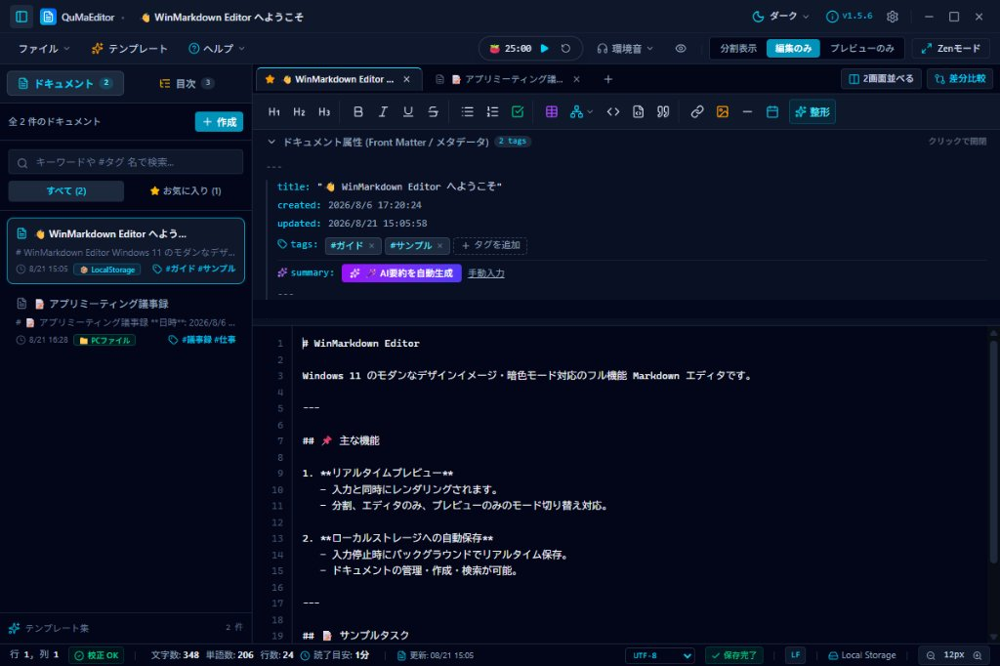

# QuMaEditor — High-Performance Native Markdown Desktop Editor

[](https://tauri.app/)
[](https://www.rust-lang.org/)
[](https://react.dev/)
[](https://www.typescriptlang.org/)
[](package.json)
[](LICENSE)

**English** | [日本語版 (Japanese)](README_JA.md)

<p align="center">
  
</p>

> **"Capture ideas in a second, refine with absolute focus."**  
> QuMaEditor (Quick & Minimal Markdown Editor) is an ultra-lightweight, high-performance desktop Markdown editor built with **Tauri v2**, **Rust**, **React 19**, and **TypeScript**.  
> Unlike traditional file-centric desktop editors, QuMaEditor features a **built-in LocalStorage document management system**. Free yourself from the friction of choosing folder paths and filenames before you start writing—open the app and begin expressing your thoughts immediately.

---

## 🌟 4 Core Values of QuMaEditor

### 1. 💾 Start Writing Instantly with "LocalStorage Integrated Document Manager"
Conventional desktop editors (e.g., VS Code or Notepad) require the repetitive cycle of "Create New ➔ Choose Directory ➔ Enter Filename" before typing, paired with intrusive "Save changes?" dialogs on exit.  
QuMaEditor integrates a **native LocalStorage document manager**:

- **Instant Auto-Save on Launch**: Begin typing right away without naming files; your content is automatically saved with intelligent title extraction into app-managed local storage.
- **Fast Note Stashing & Scratchpad**: Keep dozens of quick notes, thoughts, and drafts organized in the sidebar with full-text search, tag filtering, and favorites.
- **Export to Disk Anytime**: Once ready, convert any in-app note to a real disk file with a single click on the "💾 Save to PC File" button.
- **Local Automatic Backups & Revision History**: Automatically saves up to 20 snapshot revisions per document upon manual and debounced auto-saves. Features live character diff previews, manual snapshot captures, and one-click rollback with safety pre-restore backup.

### 2. 🧘 Total Immersion with the "Deep Focus Ecosystem (Zen Mode)"
Designed to eliminate visual and auditory distractions during writing and technical documentation:

- **Zen Writing Mode (<kbd>Ctrl + Shift + Z</kbd>)**: Hides the title bar, toolbar, sidebar, and status bar, turning your screen into a distraction-free writing sanctuary.
- **Current Line Focus Mode**: Highlights the active cursor line while gently dimming surrounding lines to keep your eyes locked on your current sentence.
- **Pomodoro Focus Timer (`FocusTimer`)**: Built-in 25m focus + 5m short break + 15m long break timer cycle with serene Web Audio sine-wave chord chimes and session completion counters (🍅 × N).
- **Zero-Dependency Ambient Soundscape Synthesizer (`AmbientSound`)**: Engineered entirely with the Web Audio API without requiring any external audio files (0KB asset overhead). Synthesizes real-time soundscapes fully offline: Gentle Rain, White Noise, Brook Stream, Forest Breeze, and Cosmic Meditation Drone.

### 3. ⚡ ~35MB RAM Footprint & Zero-Latency Rust Native Power
Eliminating the sluggishness and resource hogging common to Electron-based editors:

- **Ultra-Low Memory (~35MB RAM)**: Run comfortably in the background without depleting system resources.
- **Lag-Free Typing**: Rust-powered HTML rendering (`pulldown-cmark`, `syntect`) delivers zero-latency typing and 60fps smooth scrolling even on large Markdown documents.
- **Rock-Solid File Safety**: Prevents 0-byte file corruption using atomic temporary file writes, OS kernel file watching via `notify`, fast B-tree Rope text buffers (`ropey`), and zero-copy memory-mapped reads (`memmap2`).

### 4. 📊 Full Mermaid Integration & Obsidian-Compatible Modern Preview
Equipped with all the expressive capabilities required for specifications and software design documents:

- **Next-Gen Mermaid (Pele) Synchronous Renderer**: Sub-millisecond SVG rendering keeps typing smooth even while editing complex charts. Features 50%~600% mouse-wheel zoom, fullscreen modal zoom, **one-click SVG vector export/download**, and toolbar insertion for 8 major diagram templates.
- **Full Obsidian Syntax Compatibility**: Supports single-enter line breaks, standard callout blocks (`[!NOTE]`, `[!TIP]`, `[!WARNING]`, etc.), text highlighting (`==text==`), and internal wikilinks (`[[note]]`).

---

## 🚀 Feature Matrix

| Category | Highlights |
| :------- | :--------- |
| **Storage & File Management** | LocalStorage document manager (search, tags, favorites), disk file read/write, automated local backups & revision history (diff preview & rollback), multi-encoding auto-detection (UTF-8, Shift_JIS, EUC-JP), line-ending normalization (CRLF, LF) |
| **Editor & Writing Assistance** | Floating inline Find & Replace bar (`Ctrl+F` / `Ctrl+H`, case/word/regex options), collapsible heading outline (H1~H5 expand/collapse), Tab indentation & nested list nesting, Undo/Redo formatting integration, advanced PowerShell syntax highlighting |
| **Deep Focus (Zen Mode)** | Zen fullscreen focus mode, current line focus highlight, Pomodoro timer (🍅 counter & chord chime notification), Web Audio real-time ambient soundscapes (Rain, White Noise, Brook, Breeze, Cosmic Drone) |
| **Preview & Rendering** | Rust native HTML rendering, Next-Gen synchronous Mermaid preview (zoom, fullscreen, SVG save), Obsidian compatibility (callouts, highlights, wikilinks), side-by-side dual-pane split view, graphical diff viewer |
| **AI Summaries & Proofreading** | Google Gemini API document summarization (custom API key) + offline extractive summarizer, asynchronous Rust Japanese proofreading & syntax linting (particles, typos, unclosed brackets), live document statistics modal |
| **Export & Publishing** | Standalone self-contained HTML export (embedded Mermaid & styles), PDF export (print-optimized CSS), raw Markdown export |

---

## 💻 System Requirements & Tech Stack

| Category | Technology |
| :------- | :--------- |
| **Supported OS** | Windows 10 / 11 (x64) |
| **Application Framework** | [Tauri v2](https://v2.tauri.app/) (Rust 1.80+) |
| **Frontend** | React 19, TypeScript 5.8, Vite, Tailwind CSS v4, Lucide Icons |
| **Backend (Rust)** | pulldown-cmark, syntect, ropey, similar, notify, encoding_rs, zip |
| **Audio Synthesis Engine** | Web Audio API (Native DSP, 0KB external assets) |

---

## ⌨️ Essential Keyboard Shortcuts

| Shortcut | Action |
| :------- | :----- |
| `Ctrl + N` | Create new document (Instant LocalStorage scratchpad) |
| `Ctrl + S` | Save to disk file (Save As on first run) |
| `Ctrl + O` | Open file from disk |
| `Ctrl + F` | Toggle in-editor inline Find bar |
| `Ctrl + H` | Toggle in-editor inline Replace bar |
| `Ctrl + Shift + Z` | 🧘 Toggle Zen writing mode (Exit with `Esc`) |
| `Ctrl + Shift + D` | Open document Diff comparison modal |
| `Ctrl + Shift + F` | Auto-format Markdown tables and blank lines |
| `Ctrl + E` | Restore focus and cursor position from preview to editor |
| `F1` | Show keyboard shortcuts help cheat sheet |

---

## 🛠️ Quick Start (Development & Build)

```bash
# Install frontend dependencies
npm install

# Start local dev server and desktop app
npm run tauri dev

# Build production Windows installer (.msi / .exe)
npm run tauri build
```

---

## 📚 Documentation

- **[User Guide (USER_GUIDE)](docs/en/USER_GUIDE.md)**: UI controls, Mermaid diagrams, AI summaries, focus tools, settings, and shortcuts
- **[Technical Specifications (SPECIFICATION)](docs/en/SPECIFICATION.md)**: Core features, lifecycle, and system requirements
- **[Architecture (ARCHITECTURE)](docs/en/ARCHITECTURE.md)**: Rust/React multi-process model, data flows, and module layouts
- **[Development Guide (DEVELOPMENT)](docs/en/DEVELOPMENT.md)**: Directory layout, modularization guidelines, and verification commands
- **[Test Report (TEST_REPORT)](docs/en/TEST_REPORT.md)**: Unit test results and pre-commit verification log
- **[Release Guide (RELEASE)](docs/en/RELEASE.md)**: Version bump, tagging, and automated GitHub Actions release workflow
- **[Development Plan & TODO (TODO)](docs/en/TODO.md)**: Completed features and future roadmap
- **[Changelog (CHANGELOG)](docs/en/CHANGELOG.md)**: Version release notes

---

## 📄 License

This project is licensed under the GNU General Public License v3.0 or later (GPL-3.0-or-later) - Copyright (c) 2026 tkshnkgwr. See the [LICENSE](LICENSE) file for details.
