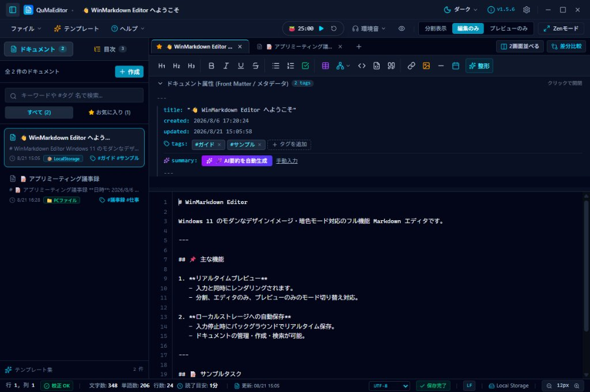

# QuMaEditor (Quick Markdown Editor) — プロ仕様デスクトップ Markdown エディタ

[](https://v2.tauri.app/)
[](https://react.dev/)
[](package.json)
[](LICENSE)

[English Version](README.md) | **日本語版**

<p align="center">
  
</p>

> **「アイデアを 1 秒で書き留め、極限の集中で仕上げる。」**  
> QuMaEditor (Quick & Minimal Markdown Editor) は、**Tauri v2**, **Rust**, **React 19**, **TypeScript** で構築された超軽量・高機能デスクトップ Markdown エディタです。  
> 一般的なファイルベースのエディタとは異なり、**アプリ内ローカルストレージ（LocalStorage）に直結したドキュメント管理システム** を標準搭載。ファイル名や保存場所を決める煩わしさから解放され、開いた瞬間から思考をそのままアウトプットできます。

---

## 🌟 QuMaEditor の 4 大コアバリュー

### 1. 💾 保存場所を気にせずすぐ書ける「LocalStorage 統合ドキュメント管理」
一般的なデスクトップエディタ（VS Code やメモ帳など）は、書き始める前に「新規作成 ➔ 保存先フォルダ選択 ➔ ファイル名入力」の手順が必要で、終了時にも保存確認ダイアログが煩わしくなりがちです。  
QuMaEditor は **LocalStorage に直結した統合ドキュメントマネージャー** を内蔵しています。

- **開いた瞬間からオートセーブ**: ファイル名を決めなくても、入力した内容がタイトル自動抽出とともにアプリ内ストレージへ即時保存。
- **アイデア・下書きの高速ストック**: 何十本もの一時メモやドラフトをサイドバーで一覧管理。全文検索、タグ絞り込み、お気に入り登録に対応。
- **いつでも実ファイル化**: メモが完成したらいつでも「💾 PCファイルに保存」ボタンからディスク上の Markdown ファイルとして書き出し可能。
- **ローカル自動バックアップ ＆ リビジョン履歴**: 実ファイル保存時および自動保存時に、最大 20 世代のスナップショットをローカルに自動保持。過去のバージョンとの差分プレビューやワンクリック復元（復元前の安全自動バックアップ付き）が可能。

### 2. 🧘 思考に完全没入する「集中執筆エコシステム (Zen Mode)」
文章の執筆やプログラミングのドキュメント作成において、視覚的・聴覚的ノイズを遮断し、極限の集中状態（フロー状態）を作り出します。

- **Zen 集中執筆モード (<kbd>Ctrl + Shift + Z</kbd>)**: タイトルバー、ツールバー、サイドバー、ステータスバーをすべて非表示にし、画面全体を純粋な執筆空間へ昇華。
- **現在行フォーカス (Focus Mode)**: 現在カーソルがある入力行のみをハイライトし、前後の行を薄暗く減光（Dim）表示。
- **ポモドーロタイマー (FocusTimer)**: 25分集中＋5分小休憩＋15分長休憩のタイマーサイクル。作業完了時には Web Audio API による澄んだ和音チャイム（ベル音）で通知し、達成セッション数（🍅 × N）をカウント。
- **ゼロ依存・リアルタイム環境音シンセサイザー (AmbientSound)**: 外部音声ファイル（MP3等）を一切使わず（アセット容量 0KB）、Web Audio API のプログラマブル音響合成により雨音、ホワイトノイズ、小川のせせらぎ、森のそよ風、宇宙ドローンをオフラインでリアルタイム生成・再生。

### 3. ⚡ メモリわずか ~35MB ＆ ゼロレイテンシの Rust ネイティブパワー
Electron 製エディタにありがちな「重い・メモリを食う・起動が遅い」を根本から解決しました。

- **メモリ消費量 ~35MB**: 常駐させても PC リソースを圧迫しません。
- **超軽快タイピング**: プレビュー解析の最適化および Rust ネイティブエンジン（`pulldown-cmark`, `syntect`）により、打鍵遅延ゼロ・秒間 60fps のスムーズスクロールを実現。
- **強固なファイル安全性**: `atomic_write` による保存時の一時ファイル置換（0 バイト破損防止）、OS カーネル直結 (`notify`) による外部ファイル更新検知、大容量 Bツリー Rope 構造 (`ropey`)、巨大ファイルのゼロコピー参照 (`memmap2`) を完備。

### 4. 📊 Mermaid 完全統合 ＆ Obsidian 互換のモダンプレビュー
技術文書、仕様書、システム設計書の作成に必要な表現力をすべて網羅しています。

- **次世代 Mermaid (Pele) レンダラー**: ミリ秒未満の同期 SVG レンダリングにより、図を編集しながらでも入力が一切カクつきません。マウスホイールによる 50%〜600% インタラクティブズーム、全画面拡大、**SVG 画像としてのワンクリック保存**、8 大ダイアグラム雛形の挿入に対応。
- **Obsidian 記法完全互換**: Enter 1 回での自然な改行、各種コールアウト記法（`[!NOTE]`, `[!TIP]`, `[!WARNING]` 等）、蛍光ペン（`==text==`）、Wiki リンク（`[[note]]`）に対応。

---

## 🚀 主な機能一覧

| カテゴリ | 機能詳細 |
| :------- | :------- |
| **ストレージ & ファイル** | LocalStorage ドキュメント管理（検索・タグ・お気に入り）、PC実ファイル保存・読込、自動バックアップ＆リビジョン履歴（差分プレビュー・復元）、文字コード自動判別（UTF-8, Shift_JIS, EUC-JP）、改行コード正規化（CRLF, LF） |
| **エディタ & 執筆補助** | エディタ内インライン検索・一括置換（`Ctrl+F` / `Ctrl+H`、大文字小文字・単語一致・正規表現）、見出しアウトライン（H1〜H5折りたたみ・展開）、Tab インデント＆箇条書き階層化、文字装飾 Undo/Redo 連動、PowerShell 構文ハイライト強化 |
| **集中執筆 (Zen Mode)** | Zen フルスクリーン集中モード、現在行ハイライトフォーカス、ポモドーロタイマー（🍅 カウント＆和音ベル通知）、Web Audio リアルタイム環境音 BGM（雨音・ホワイトノイズ・せせらぎ・風・瞑想ドローン） |
| **プレビュー & 描画** | Rust ネイティブ高速 HTML レンダリング、次世代 Mermaid 同期描画（ズーム・全画面・SVG 保存）、Obsidian 互換（コールアウト・ハイライト・Wikiリンク）、デュアルペイン 2 画面並列比較編集、ドキュメント差分比較 (Diff Viewer) |
| **AI 要約 & 品質校正** | Google Gemini API 自動要約（APIキー自由指定）＋ オフライン要約エンジン、Rust 非同期日本語校正＆記法 Lint（助詞連続・表記ゆれ・未閉じ括弧検出）、詳細統計モーダル（文字数・単語数・読了目安時間） |
| **出力 & エクスポート** | スタンドアロン HTML 出力（Mermaid・スタイル完全内包）、PDF 出力（印刷ダイアログ最適化）、Markdown エクスポート |

---

## 💻 動作要件・技術スタック

| 区分 | 採用技術 |
| :--- | :------- |
| **対応 OS** | Windows 10 / 11 (x64) |
| **フレームワーク** | [Tauri v2](https://v2.tauri.app/) (Rust 1.80+) |
| **フロントエンド** | React 19, TypeScript 5.8, Vite, Tailwind CSS v4, Lucide Icons |
| **バックエンド (Rust)** | pulldown-cmark, syntect, ropey, similar, notify, encoding_rs, zip |
| **音響合成エンジン** | Web Audio API (Native DSP, 外部アセット 0KB) |

---

## ⌨️ 主なショートカットキー

| ショートカット | 機能 |
| :------------- | :--- |
| `Ctrl + N` | 新規ドキュメント作成 (LocalStorage 即時作成) |
| `Ctrl + S` | 実ファイルに保存 (初回は名前を付けて保存) |
| `Ctrl + O` | PC 上のファイルを開く |
| `Ctrl + F` | エディタ内インライン検索バーを開く |
| `Ctrl + H` | エディタ内インライン置換バーを開く |
| `Ctrl + Shift + Z` | 🧘 Zen 集中執筆モード切り替え (解除は `Esc`) |
| `Ctrl + Shift + D` | ドキュメント差分比較モーダル (Diff) の起動 |
| `Ctrl + Shift + F` | Markdown 表組み・空行の自動整形フォーマット |
| `Ctrl + E` | プレビューからエディタへフォーカス復帰（カーソル位置復元） |
| `F1` | キーボードショートカット一覧ヘルプの表示 |

---

## 🛠️ クイックスタート (開発・ビルド)

```bash
# 依存関係のインストール
npm install

# 開発サーバーおよびデスクトップアプリの起動
npm run tauri dev

# リリースビルド（Windows インストーラー .msi / .exe の生成）
npm run tauri build
```

---

## 📚 ドキュメント一覧

- **[操作マニュアル (USER_GUIDE)](docs/ja/USER_GUIDE.md)**: 基本操作、Mermaid、AI要約、集中ツール、設定、ショートカット一覧
- **[機能・技術仕様書 (SPECIFICATION)](docs/ja/SPECIFICATION.md)**: コア機能一覧、ライフサイクル、システム要件
- **[アーキテクチャ設計書 (ARCHITECTURE)](docs/ja/ARCHITECTURE.md)**: Rust/React マルチプロセス構成、データフロー、モジュール構造
- **[開発ガイド (DEVELOPMENT)](docs/ja/DEVELOPMENT.md)**: ディレクトリ構成、モジュール分割基準、事前検証手順
- **[テスト実行報告書 (TEST_REPORT)](docs/ja/TEST_REPORT.md)**: ユニットテストおよび事前検証結果
- **[リリース手順書 (RELEASE)](docs/ja/RELEASE.md)**: バージョンアップ・タグ付け・CI/CD 自動リリース手順
- **[開発計画・TODO リスト (TODO)](docs/ja/TODO.md)**: 完了済み機能および開発ロードマップ
- **[更新履歴 (CHANGELOG)](docs/ja/CHANGELOG.md)**: バージョン別変更履歴

---

## 📄 ライセンス

本プロジェクトは GNU General Public License v3.0 or later (GPL-3.0-or-later) のもとで公開されています - Copyright (c) 2026 tkshnkgwr。詳細は [LICENSE](LICENSE) をご覧ください。
