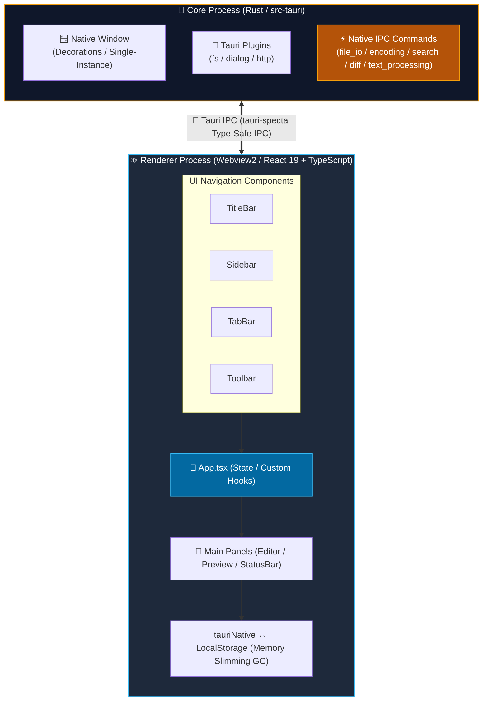
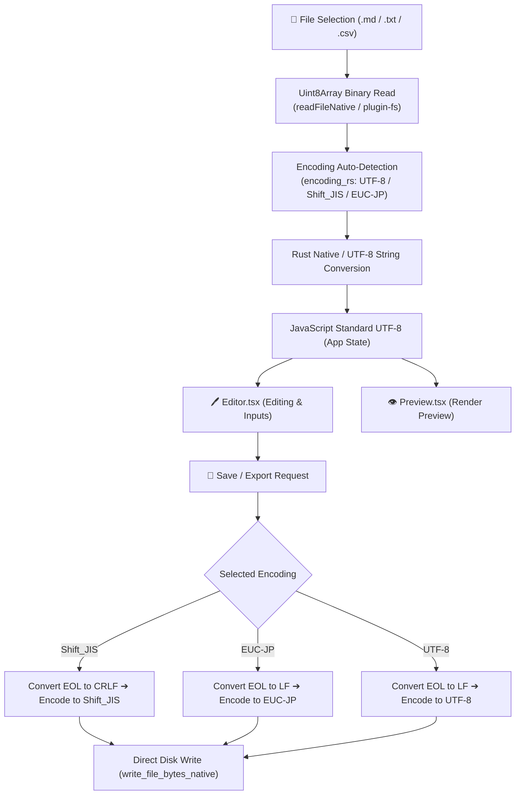

# Architecture Document (ARCHITECTURE)

**English** | [日本語版](../ja/ARCHITECTURE.md)

---

## 1. Process Model (Tauri Process Architecture)

This application adopts a multi-process desktop model powered by the Tauri v2 framework. The backend core process built in Rust communicates securely and efficiently with the Webview2 (React 19 + TypeScript) renderer process via IPC.

---

## 2. Character Encoding & Data Flow

Data processing flow for file imports and exports:

---

## 3. Persistence Architecture

- **Main Storage**: Browser `LocalStorage` key `markdown_editor_docs_v1` combined with Tauri native filesystem APIs.
- **Debounce Control**: Delayed writing via `autoSaveIntervalMs` (default 3000ms) timer to avoid performance degradation on every keystroke.
- **Memory Slimming GC**: Saved PC disk documents are converted to lightweight placeholders (`<!-- [STORAGE_SLIMMED_LOAD_FROM_DISK] -->`) during LocalStorage persistence to prevent `QuotaExceededError`.
- **Data Compatibility**: Preserves selected encoding configuration per document by persisting the `encoding` property in document state.

---

## 4. Rust Native Commands

| Command Name                     | Description                                                                                            |
| :------------------------------- | :----------------------------------------------------------------------------------------------------- |
| `detect_and_convert_to_utf8`     | Auto-detect character encoding from byte array and decode to UTF-8                                     |
| `convert_utf8_to_encoding`       | Encode UTF-8 string into target character encoding byte vector                                         |
| `read_file_native`               | Fast and reliable direct local file reading without browser sandbox permission limits                  |
| `read_file_chunk_native`         | Partial streaming read of large files from a specified byte offset (lazy loading)                      |
| `write_file_native`              | Direct UTF-8 text overwrite persistence to the specified file path                                     |
| `write_file_bytes_native`        | Direct disk persistence of raw byte arrays encoded in the target character encoding                    |
| `get_file_metadata_native`       | Fast retrieval of file existence, last modified timestamp (`mtime`), and byte size                     |
| `open_folder_native`             | Opens parent directory in Windows Explorer (`explorer.exe`) with the target file highlighted           |
| `index_documents_native`         | Batch registration of documents into the in-memory inverted search index                               |
| `search_documents_native`        | High-speed Rust full-text search using the in-memory inverted index                                    |
| `parse_markdown_native`          | Fast Markdown syntax parsing via `pulldown-cmark`                                                      |
| `compute_text_diff_native`       | Real-time line-by-line diff calculation via the `similar` crate                                        |
| `calculate_text_stats_native`    | Fast native calculation of real-time character, word, line counts, and estimated reading time          |
| `parse_yaml_front_matter_native` | High-speed separation and metadata parsing of YAML Front Matter and Markdown body                      |
| `extract_headings_native`        | Fast extraction of H1~H6 heading outline trees from Markdown text                                      |
| `toggle_task_native`             | Fast task list checkbox state toggling                                                                 |
| `format_markdown_native`         | Native Markdown auto-formatting (vertical table alignment, blank line compression, heading spacing)    |
| `render_markdown_html_native`    | High-speed HTML rendering with `syntect` syntax highlighting and Obsidian callout/wikilink extensions  |
| `export_html_full_native`        | Standalone HTML document export generation with embedded CSS and Mermaid auto-rendering                |
| `atomic_write_file_native`       | Corruption-safe atomic UTF-8 file persistence via staged temp file and rename (`mtime` guaranteed)     |
| `atomic_write_file_bytes_native` | Corruption-safe atomic raw byte persistence via staged temp file and rename (`mtime` guaranteed)       |
| `search_workspace_dir_native`    | Parallel multithreaded full-text search across workspace directories via `rayon`                       |
| `rope_init_buffer`, etc.         | Large text B-tree Rope buffer management via `ropey` (slicing, line extraction, $O(\log N)$ edits)     |
| `sync_register_file`, etc.       | Centralized disk `mtime`, self-save lock, and bidirectional sync management via `FileSyncManager`      |
| `watch_file_native`, etc.        | OS kernel-connected external file modification monitoring and filtering via `notify`                   |
| `compute_detailed_diff_native`   | High-speed line-number and word-level inline diff (`inline_changes`) calculation via `similar`         |
| `export_notes_to_zip_native`     | Batch ZIP archive export of multiple notes and assets using Deflate compression via `zip`              |
| `lint_markdown_document_native`  | Asynchronous background proofreading for duplicate particles, spelling variants, and unclosed blocks   |
| `validate_mermaid_syntax_native` | Mermaid syntax pre-validation and SVG in-memory diff cache optimization via SHA-256 hashing            |
| `mmap_read_file_chunk_native`    | Zero-copy instant opening and slicing of massive files via `memmap2` OS virtual memory mapping         |
| `scan_workspace_tree_native`     | `.gitignore`-compliant multithreaded parallel workspace file tree scanning via `ignore`                |

---

## 5. Backend Modular Architecture

```mermaid
graph TD
    subgraph Core["Tauri Application Entry"]
        Lib["lib.rs<br/>(Runner / Plugin Init / Specta Export)"]
        GenSpecta["bin/gen_specta.rs<br/>(TS Binding Generator)"]
    end

    subgraph CommandLayer["IPC Command Layer"]
        Commands["commands.rs<br/>(tauri::command / Specta DTO)"]
    end

    subgraph DomainModules["Domain Modules"]
        FileIO["file_io.rs<br/>(Native File I/O & Atomic Write)"]
        Encoding["encoding.rs<br/>(Multi-Encoding Detection)"]
        Search["search.rs<br/>(In-Memory & rayon Parallel Search)"]
        Diff["diff.rs<br/>(Text Diff & pulldown-cmark)"]
        TextProc["text_processing/<br/>(Stats, Headings, Formatter, HTML)"]
        Rope["rope_buffer.rs<br/>(ropey B-Tree Buffer)"]
        SyncMgr["sync_manager.rs<br/>(FileSyncManager)"]
        Watcher["file_watcher.rs<br/>(notify OS Watcher)"]
        ZipMod["export_zip.rs<br/>(zip Archive Deflate)"]
        ProofMod["proofreading.rs<br/>(Grammar & Markdown Lint)"]
        MermaidMod["mermaid_validator.rs<br/>(Syntax Check & Hash)"]
        MmapMod["mmap_reader.rs<br/>(memmap2 Zero-Copy)"]
        ScannerMod["workspace_scanner.rs<br/>(ignore Parallel Tree)"]
    end

    Lib --> Commands
    GenSpecta --> Commands
    Commands --> FileIO
    Commands --> Encoding
    Commands --> Search
    Commands --> Diff
    Commands --> TextProc
    Commands --> Rope
    Commands --> SyncMgr
    Commands --> Watcher
    Commands --> ZipMod
    Commands --> ProofMod
    Commands --> MermaidMod
    Commands --> MmapMod
    Commands --> ScannerMod
```

| Module Name         | File Path                                                                        | Responsibilities & Description                                                                                   |
| :------------------ | :------------------------------------------------------------------------------- | :--------------------------------------------------------------------------------------------------------------- |
| `lib`               | [`src-tauri/src/lib.rs`](../../src-tauri/src/lib.rs)                             | Main entrypoint, plugin initialization, and Specta TypeScript binding generator handler                          |
| `commands`          | [`src-tauri/src/commands.rs`](../../src-tauri/src/commands.rs)                   | IPC command handlers exposed to TypeScript and Specta macro mappings                                             |
| `encoding`          | [`src-tauri/src/encoding.rs`](../../src-tauri/src/encoding.rs)                   | Multi-encoding auto-detection (UTF-8, Shift_JIS, EUC-JP) and conversion via `encoding_rs`                        |
| `file_io`           | [`src-tauri/src/file_io.rs`](../../src-tauri/src/file_io.rs)                     | Native file reading, atomic file persistence, chunked streaming, direct byte writing, and folder opening         |
| `search`            | [`src-tauri/src/search.rs`](../../src-tauri/src/search.rs)                       | Inverted index search engine and `rayon` multithreaded directory full-text search                                |
| `diff`              | [`src-tauri/src/diff.rs`](../../src-tauri/src/diff.rs)                           | Line-by-line and token-level diffing via `similar` crate and native Markdown HTML parsing via `pulldown-cmark`   |
| `text_processing`   | [`src-tauri/src/text_processing/`](../../src-tauri/src/text_processing/)         | Text stats calculation, YAML front matter parser, heading outline, table alignment formatting, syntect HTML      |
| `rope_buffer`       | [`src-tauri/src/rope_buffer.rs`](../../src-tauri/src/rope_buffer.rs)             | `ropey` crate B-tree Rope buffer management ($O(\log N)$ edits, slicing, and chunking for 100MB+ files)          |
| `sync_manager`      | [`src-tauri/src/sync_manager.rs`](../../src-tauri/src/sync_manager.rs)           | `FileSyncManager` engine for disk mtime synchronization, self-save locks, and race condition prevention          |
| `file_watcher`      | [`src-tauri/src/file_watcher.rs`](../../src-tauri/src/file_watcher.rs)           | OS kernel-connected external file modification monitoring via the `notify` crate                                 |
| `export_zip`        | [`src-tauri/src/export_zip.rs`](../../src-tauri/src/export_zip.rs)               | Fast in-memory Deflate compression and batch ZIP export for documents and assets via `zip` crate                 |
| `proofreading`      | [`src-tauri/src/proofreading.rs`](../../src-tauri/src/proofreading.rs)           | Non-blocking asynchronous background analysis of duplicate particles, variant spellings, brackets, and lint rules|
| `mermaid_validator` | [`src-tauri/src/mermaid_validator.rs`](../../src-tauri/src/mermaid_validator.rs) | Mermaid syntax pre-validation, diagram type detection, and SHA-256 hash calculation for SVG diff caching         |
| `mmap_reader`       | [`src-tauri/src/mmap_reader.rs`](../../src-tauri/src/mmap_reader.rs)             | OS virtual memory page cache integration via `memmap2` for zero-copy instant opening of massive log files        |
| `workspace_scanner` | [`src-tauri/src/workspace_scanner.rs`](../../src-tauri/src/workspace_scanner.rs) | Multithreaded parallel directory tree traversal respecting `.gitignore` via `ignore` crate                       |

---

## 6. Frontend Component Architecture (Renderer Process)

To ensure high maintainability and prevent single-file code bloat, all frontend source files are strictly kept under 1,000 lines through clean modular decomposition.

```mermaid
graph TD
    App["App.tsx<br/>(Master Layout & State Mediation)"]

    subgraph CustomHooks["Custom Hooks"]
        useDoc["useDocumentManager.ts<br/>(Document Lifecycle & Summary Sync)"]
        useDnD["useWindowDragDrop.ts<br/>(Tauri / HTML5 D&D Engine)"]
        useToolbar["useEditorToolbarActions.ts<br/>(Formatting / Tables / TOC Navigation)"]
        useDual["useDualPane.ts<br/>(Dual Pane Splitter & Focus)"]
        useShortcuts["useGlobalShortcuts.ts<br/>(Global Keybindings)"]
    end

    subgraph UIComponents["Key UI Components"]
        DualPane["DualPaneWorkspace.tsx<br/>(Split Workspace Layout)"]
        Editor["Editor.tsx<br/>(Textarea & Front Matter Panel)"]
        Preview["Preview.tsx<br/>(Rust HTML, Obsidian Callouts, Segmentation)"]
        MermaidComp["MermaidRenderer.tsx<br/>(Zoom, Fullscreen Modal, SVG Save)"]
        StatusBar["StatusBar.tsx<br/>(Metrics, Proofreading Tooltip, Sync)"]
        SettingsModal["SettingsModal.tsx<br/>(Modal Shell: 286 Lines)"]
    end

    subgraph SettingsTabs["Modular Settings Tabs"]
        GeneralTab["settings/GeneralTab.tsx<br/>(Appearance, Fonts, Auto-Save)"]
        AiTab["settings/AiTab.tsx<br/>(Gemini API, Models, Testing)"]
        StorageTab["settings/StorageTab.tsx<br/>(Storage Quotas, ZIP Export)"]
    end

    subgraph UtilityModules["Utilities & API Layer"]
        AiSummary["aiSummary.ts<br/>(Gemini API, safeFetch, Fallback)"]
        YamlUtils["yamlUtils.ts<br/>(YAML Parsing & Front Matter Sync)"]
        TableUtils["tableUtils.ts<br/>(Interactive Markdown Table Editing)"]
        TauriNative["tauriNative.ts<br/>(Rust IPC Command Bridge)"]
    end

    App --> useDoc
    App --> useDnD
    App --> useToolbar
    App --> useDual
    App --> useShortcuts
    App --> DualPane
    App --> StatusBar
    App --> SettingsModal

    DualPane --> Editor
    DualPane --> Preview
    Preview --> MermaidComp

    SettingsModal --> GeneralTab
    SettingsModal --> AiTab
    SettingsModal --> StorageTab

    Editor --> YamlUtils
    Editor --> AiSummary
    useToolbar --> TableUtils
    useDoc --> TauriNative
```

| Path                                     | Responsibilities & Architecture Description                                                           |
| :--------------------------------------- | :---------------------------------------------------------------------------------------------------- |
| `src/App.tsx`                            | Root controller coordinating layout, custom hooks, and modal triggers (<1,000 lines)                  |
| `src/hooks/useDocumentManager.ts`        | Centralized lifecycle management for document creation, loading, disk saves, tags, and AI summaries   |
| `src/hooks/useWindowDragDrop.ts`         | Native Tauri and HTML5 drag-and-drop handler for external files (.md, .txt) and image data embedding  |
| `src/hooks/useEditorToolbarActions.ts`   | Centralized actions for toolbar formatting (bold, italic, underline), table generation, and headings  |
| `src/components/MermaidRenderer.tsx`     | Mermaid dynamic SVG rendering, interactive zoom, fullscreen modal, SVG file save, and syntax alerts   |
| `src/components/SettingsModal.tsx`       | Container modal shell managing tab transitions (286 lines, ~69% reduction)                            |
| `src/components/settings/GeneralTab.tsx` | General editor preferences, typography, line height, auto-save interval, and syntax themes            |
| `src/components/settings/AiTab.tsx`      | Google Gemini API configuration, model selection, custom endpoint, prompt tuning, and live test       |
| `src/components/settings/StorageTab.tsx` | Storage quota analytics, document counting, batch ZIP archiving, and cache reset                      |
| `src/utils/aiSummary.ts`                 | Google Gemini API (`@google/genai`) client with Tauri HTTP plugin bridge and offline local fallback   |
| `src/utils/tableUtils.ts`                | Interactive keyboard navigation (Tab / Shift+Tab / Enter) and auto-formatting for Markdown tables     |

