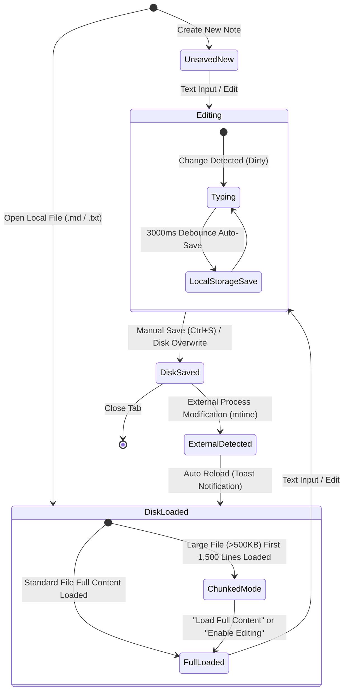

# Specification & Technical Design (SPECIFICATION)

**English** | [日本語版](../ja/SPECIFICATION.md)

## 1. Overview

QuMaEditor is a performance-first desktop Markdown editor built with **Tauri v2**, **Rust**, **React 19**, and **TypeScript**.

---

## 2. Core Features & Specifications

| Category          | Feature Name                                 | Implementation / Technical Details                                                                                             |
| :---------------- | :------------------------------------------- | :----------------------------------------------------------------------------------------------------------------------------- |
| **Editing**       | Side-by-Side Dual-Pane Editing & Preview     | `DualPaneWorkspace` & `useDualPane` for dual document editing, synchronized view mode, 4-way split suppression, focus tracking |
| **Editing**       | Zero-Latency Typing                          | Complete preview unmounting in Editor Only mode, `useDeferredValue` async parsing in Split view                                |
| **Editing**       | `Ctrl + E` Focus Restoration                 | Preserves caret position/selection when toggling view modes, instantly refocused                                               |
| **Editing**       | Native Markdown Auto-Formatting              | Rust `formatter.rs` table vertical alignment, heading spacing, blank line collapsing                                           |
| **Editing**       | Tab Indentation & Nested Lists               | Tab bullet increment (`- ` ➔ `  - `), multi-line block indent, `Shift+Tab` unindent                                            |
| **Editing**       | Large Document Rope Buffer                   | B-Tree `ropey` buffer management; $O(\log N)$ edits and slicing for 100MB+ documents                                           |
| **Editing**       | Typewriter Scrolling                         | Automatically keeps the active cursor line vertically centered on the screen                                                   |
| **Editing**       | Formatting Undo/Redo Integration             | `applyTextReplacementWithUndo` preserving native browser Undo/Redo stack, toolbar focus retention (`preventDefault`)           |
| **Editing**       | Underline Shortcut (`Ctrl+U`)                | Inserts `<u>...</u>` tags and wraps selection via `Ctrl+U`                                                                     |
| **Editing**       | Toolbar Mermaid Template Dropdown            | One-click insertion of 8 major diagram templates (flowchart, sequence, state, class, ER, mindmap, gantt, git)                  |
| **Proofreading**  | Japanese Proofreading & Syntax Linting       | Rust background worker checking duplicate particles, variant spellings, brackets, and code blocks                              |
| **Navigation**    | Heading Outline & TOC Tree                   | Native H1~H6 extraction, indentation badges, keyword filter, bi-directional jump scrolling                                     |
| **Preview**       | Pure Rust Native HTML Rendering              | Zero-latency 60fps rendering via `pulldown-cmark` + `syntect` with interactive task lists                                      |
| **Preview**       | Complete Mermaid Preview Integration         | Seamless Rust preview mounting, zoom (50%~600%), fullscreen modal, syntax error notifications, and SHA-256 caching             |
| **Preview**       | Enhanced PowerShell Highlighting             | Prism/Refractor grammar extension for parameters, operators, numbers, and aliases (`ps`, `posh`)                               |
| **File I/O**      | Atomic File Persistence & Instant mtime      | Staged temporary write and OS-level atomic replace to prevent 0-byte corruption                                                |
| **File I/O**      | Standalone HTML Export (Mermaid Auto-Render) | `export_html_full_native` embedding Mermaid CDN & auto-init scripts for browser standalone rendering & print CSS               |
| **File I/O**      | Batch Notes & Asset ZIP Export               | High-speed in-memory Deflate archive creation via the `zip` crate                                                              |
| **File I/O**      | Memory-Mapped Zero-Copy Streaming            | OS virtual memory page cache integration via `memmap2` for instant 0s multi-gigabyte log loading                               |
| **File I/O**      | Large File Streaming                         | `read_file_chunk_native` 1,500-line chunk on-demand lazy loading                                                               |
| **Data Safety**   | LocalStorage Dual Persistence                | 3-second debounce auto-save, 100% crash recovery                                                                               |
| **Sync**          | Bidirectional Sync Manager                   | Centralized `FileSyncManager` resolving mtime locks, race conditions, and self-save events                                     |
| **Sync**          | Native OS-Level File Watching                | Windows kernel event listening (`ReadDirectoryChangesW`) via `notify` with 0% idle CPU overhead                                |
| **Search**        | Workspace Parallel Full-Text Search          | Multithreaded parallel directory scan via `rayon` combined with in-memory inverted indexing                                    |
| **Search**        | Parallel Workspace Tree Traversal            | Fast multi-threaded filesystem walker honoring `.gitignore` via `ignore` crate                                                 |
| **Encoding**      | Multi-Encoding Support (UTF-8, SJIS, EUC-JP) | `encoding_rs` native engine, automatic EOL (CRLF / LF) synchronization                                                         |
| **Statistics**    | Statistics Dashboard (`StatsModal`)          | Real-time character, word, line, reading time, heading, and link aggregation                                                   |
| **Diff**          | Native Detailed Text Diff                    | Line-by-line and token-level inline diff visual comparison via `similar` crate                                                 |
| **AI Summary**    | AI Document Summary & Hybrid Fallback        | Google Gemini API (`@google/genai`), user model choice, prompt editing, connectivity test & local fallback                     |
| **Metadata**      | YAML Front Matter & Summary Cards            | Rust `yaml.rs` & React sync for `summary` / `summary_type`, editor controls, and preview summary card                          |
| **UI / Settings** | Modular Settings Modal (`SettingsModal`)     | 3-tab layout (General, AI, Storage) strictly adhering to <1,000 lines architecture guidelines                                  |

---

## 3. Document Lifecycle Architecture

---

## 4. System Requirements

| Item     | Details                                  |
| :------- | :--------------------------------------- |
| Version  | v1.5.2                                   |
| OS       | Windows 10 / 11 (Tauri v2 Native Window) |
| Runtime  | Rust Native Engine + WebView2            |
| Frontend | React 19 + TypeScript 5.8                |
