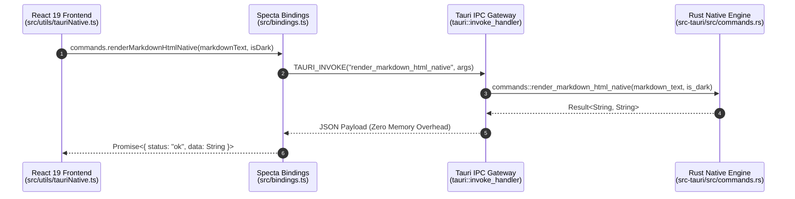

# Tauri v2 IPC Development & Test Guide (TAURI_GUIDE)

**English** | [日本語版](../ja/TAURI_GUIDE.md)

## 1. Tauri v2 IPC Architecture

QuMaEditor utilizes high-speed **IPC (Inter-Process Communication)** between React 19 Frontend and Rust Backend Engine.

---

## 2. IPC Commands List & DTO Definitions

| Command Name                     | Arguments                                            | Return Type                         | Description                                                                   |
| :------------------------------- | :--------------------------------------------------- | :---------------------------------- | :---------------------------------------------------------------------------- |
| `detect_and_convert_to_utf8`     | `bytes: Vec<u8>`                                     | `Result<EncodingDetectResult>`      | Auto-detect character encoding and decode to UTF-8 string                     |
| `convert_utf8_to_encoding`       | `text: String, target_encoding: String`              | `Result<Vec<u8>>`                   | Encode UTF-8 text into target encoding byte vector                            |
| `read_file_native`               | `file_path: String`                                  | `Result<EncodingDetectResult>`      | Fast native file reader with encoding auto-detection                          |
| `read_file_chunk_native`         | `file_path: String, offset: u64, max_bytes: usize`   | `Result<FileChunkResult>`           | 10MB+ large file streaming in memory chunks                                   |
| `index_documents_native`         | `docs: Vec<DocSearchInput>`                          | `Result<bool>`                      | Batch registration to in-memory inverted search index                         |
| `search_documents_native`        | `query: String`                                      | `Result<Vec<SearchResult>>`         | Inverted index full-text search with multibyte safety                         |
| `search_workspace_dir_native`    | `dir_path: String, query: String, max_results: u32`  | `Result<Vec<WorkspaceSearchMatch>>` | Multithreaded parallel full-text search across workspace directory (`rayon`)  |
| `compute_text_diff_native`       | `old_text: String, new_text: String`                 | `Result<Vec<TextDiffChunk>>`        | Line-by-line diff calculation using `similar` crate                           |
| `compute_detailed_diff_native`   | `old_text: String, new_text: String`                 | `Result<DetailedDiffResultDto>`     | Detailed diff with old/new line numbers and token-level `inline_changes`      |
| `parse_markdown_native`          | `markdown_text: String`                              | `Result<String>`                    | Fast Markdown to HTML parser using `pulldown-cmark`                           |
| `write_file_bytes_native`        | `file_path: String, bytes: Vec<u8>`                  | `Result<FileWriteResultDto>`        | Direct byte array disk persistence returning latest `mtime`                   |
| `write_file_native`              | `file_path: String, content: String`                 | `Result<bool>`                      | Direct UTF-8 string disk persistence                                          |
| `atomic_write_file_bytes_native` | `file_path: String, bytes: Vec<u8>`                  | `Result<FileWriteResultDto>`        | Atomic byte array persistence preventing corruption and returning `mtime`     |
| `atomic_write_file_native`       | `file_path: String, content: String`                 | `Result<FileWriteResultDto>`        | Atomic UTF-8 string persistence preventing corruption and returning `mtime`   |
| `calculate_text_stats_native`    | `text: String`                                       | `Result<TextStatsDto>`              | Real-time character, word, and reading time counter                           |
| `parse_yaml_front_matter_native` | `content: String`                                    | `Result<ParsedYamlDocResult>`       | Fast YAML front matter parsing and metadata (tags, AI summary) extraction     |
| `extract_headings_native`        | `markdown_text: String`                              | `Result<Vec<HeadingItemDto>>`       | Extracts H1~H6 outline tree from Markdown text                                |
| `toggle_task_native`             | `markdown_text: String, target_index: u32`           | `Result<String>`                    | Toggles task checkbox state (`- [ ]` ↔ `- [x]`) at target task index          |
| `export_html_full_native`        | `title: String, markdown_text: String, is_dark: bool`| `Result<String>`                    | Generates standalone HTML document with Mermaid auto-rendering and CSS        |
| `format_markdown_native`         | `markdown_text: String`                              | `Result<String>`                    | Markdown auto-formatting (align tables, insert blank lines, collapse blanks)  |
| `render_markdown_html_native`    | `markdown_text: String, is_dark: bool`               | `Result<String>`                    | `syntect` syntax highlighted & Obsidian-compatible HTML rendering             |
| `get_file_metadata_native`       | `file_path: String`                                  | `Result<FileMetadataDto>`           | Fast retrieval of file existence, `mtime`, and byte size                      |
| `open_folder_native`             | `file_path: String`                                  | `Result<bool>`                      | Opens parent directory in Windows Explorer with file highlighted              |
| `rope_init_buffer`, etc.         | `doc_id: String, text: String`, etc.                 | `Result<RopeStatsDto>`, etc.        | B-tree Rope buffer initialization, editing, line slicing, and cleanup (`ropey`)|
| `sync_register_file`, etc.       | `file_path: String`, etc.                            | `Result<FileSyncStatusDto>`, etc.   | `FileSyncManager` mtime tracking, self-save locks, and external change checks |
| `watch_file_native`, etc.        | `app: AppHandle, file_path: String`, etc.            | `Result<bool>`                      | OS-kernel file watching registration and unregistration via `notify` crate    |
| `export_notes_to_zip_native`     | `zip_path: String, entries: Vec<ZipNoteEntryDto>`    | `Result<ZipExportResultDto>`        | Batch Deflate ZIP archive export for notes and assets via `zip` crate         |
| `lint_markdown_document_native`  | `text: String`                                       | `Result<ProofreadResultDto>`        | Async background proofreading & syntax linting (particles, variants, blocks)  |
| `validate_mermaid_syntax_native` | `code: String`                                       | `Result<MermaidValidationDto>`      | Mermaid syntax pre-validation, diagram type detection, and SHA-256 hash       |
| `mmap_read_file_chunk_native`    | `file_path: String, offset: u64, max_bytes: u32`     | `Result<MmapSliceDto>`              | Zero-copy memory-mapped file slice streaming via `memmap2`                    |
| `scan_workspace_tree_native`     | `root_dir: String, max_files: u32`                   | `Result<WorkspaceScanResultDto>`    | Parallel workspace directory tree traversal honoring `.gitignore` (`ignore`)  |
