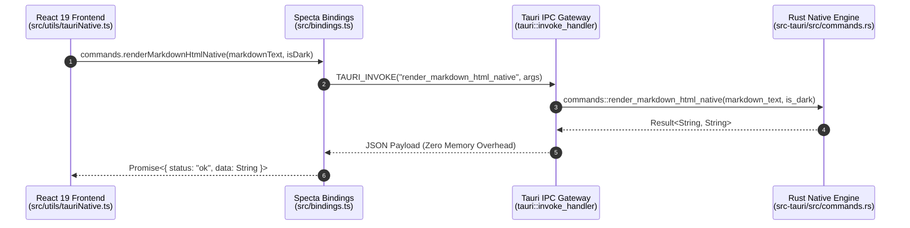

# Tauri v2 IPC 開発・テスト仕様書 (TAURI_GUIDE)

[English](../en/TAURI_GUIDE.md) | **日本語版**

## 1. Tauri v2 IPC 通信アーキテクチャ

QuMaEditor は、フロントエンド (React 19 + TypeScript) とバックエンド (Rust Engine) 間で高速な **IPC (Inter-Process Communication)** 通信を行っています。

---

## 2. IPC コマンド一覧 & DTO 定義

| コマンド名                       | 引数                                                 | 戻り値                              | 概要                                                                         |
| :------------------------------- | :--------------------------------------------------- | :---------------------------------- | :--------------------------------------------------------------------------- |
| `detect_and_convert_to_utf8`     | `bytes: Vec<u8>`                                     | `Result<EncodingDetectResult>`      | バイト配列の文字コード自動判別 & UTF-8 デコード                              |
| `convert_utf8_to_encoding`       | `text: String, target_encoding: String`              | `Result<Vec<u8>>`                   | 指定エンコーディングへのエンコード保存バイト生成                             |
| `read_file_native`               | `file_path: String`                                  | `Result<EncodingDetectResult>`      | ファイルパス指定による高速読込・エンコーディング判定                         |
| `read_file_chunk_native`         | `file_path: String, offset: u64, max_bytes: usize`   | `Result<FileChunkResult>`           | 10MB+ 大容量ファイルのメモリ分割ストリーミング                               |
| `index_documents_native`         | `docs: Vec<DocSearchInput>`                          | `Result<bool>`                      | 転置インデックス検索エンジンへの一括登録                                     |
| `search_documents_native`        | `query: String`                                      | `Result<Vec<SearchResult>>`         | 単語・行単位爆速全文検索（マルチバイト文字安全）                             |
| `search_workspace_dir_native`    | `dir_path: String, query: String, max_results: u32`  | `Result<Vec<WorkspaceSearchMatch>>` | `rayon` マルチスレッド並列走査によるフォルダ内全文検索                       |
| `compute_text_diff_native`       | `old_text: String, new_text: String`                 | `Result<Vec<TextDiffChunk>>`        | `similar` クレートによる行単位差分算出                                       |
| `compute_detailed_diff_native`   | `old_text: String, new_text: String`                 | `Result<DetailedDiffResultDto>`     | 行番号 Old/New および単語レベルインライン差分（`inline_changes`）算出        |
| `parse_markdown_native`          | `markdown_text: String`                              | `Result<String>`                    | `pulldown-cmark` 高速 Markdown -> HTML 変換                                  |
| `write_file_bytes_native`        | `file_path: String, bytes: Vec<u8>`                  | `Result<FileWriteResultDto>`        | バイト配列のネイティブ直書き保存（最新 mtime 返却）                          |
| `write_file_native`              | `file_path: String, content: String`                 | `Result<bool>`                      | UTF-8 テキストのネイティブ直書き保存                                         |
| `atomic_write_file_bytes_native` | `file_path: String, bytes: Vec<u8>`                  | `Result<FileWriteResultDto>`        | 生バイト配列のアトミック書き込み保存（破損防止・mtime 保証）                 |
| `atomic_write_file_native`       | `file_path: String, content: String`                 | `Result<FileWriteResultDto>`        | UTF-8 テキストのアトミック書き込み保存（破損防止・mtime 保証）               |
| `calculate_text_stats_native`    | `text: String`                                       | `Result<TextStatsDto>`              | リアルタイム文字数・単語数・読了時間高速算出                                 |
| `parse_yaml_front_matter_native` | `content: String`                                    | `Result<ParsedYamlDocResult>`       | YAML Front Matter メタデータ（タグ・AI要約等）の高速パース                   |
| `extract_headings_native`        | `markdown_text: String`                              | `Result<Vec<HeadingItemDto>>`       | Markdown からの H1〜H6 見出し目次ツリー抽出                                  |
| `toggle_task_native`             | `markdown_text: String, target_index: u32`           | `Result<String>`                    | 指定インデックスのタスク項目 (`- [ ]` ↔ `- [x]`) の高速状態トグル            |
| `export_html_full_native`        | `title: String, markdown_text: String, is_dark: bool`| `Result<String>`                    | Mermaid 自動描画・シンタックスハイライト付き完全スタンドアロン HTML 生成     |
| `format_markdown_native`         | `markdown_text: String`                              | `Result<String>`                    | 表組み垂直整列・過剰空行圧縮・見出し空行自動挿入のネイティブ自動整形         |
| `render_markdown_html_native`    | `markdown_text: String, is_dark: bool`               | `Result<String>`                    | `syntect` 構文ハイライト＆Obsidian 拡張対応の高速 HTML レンダリング          |
| `get_file_metadata_native`       | `file_path: String`                                  | `Result<FileMetadataDto>`           | ファイル存在有無、最終更新日時 (`mtime`)、ファイルサイズの高速取得           |
| `open_folder_native`             | `file_path: String`                                  | `Result<bool>`                      | 対象ファイルをハイライト選択した状態で Windows エクスプローラーを安全オープン|
| `rope_init_buffer` 等            | `doc_id: String, text: String` 他                    | `Result<RopeStatsDto>` 他           | `ropey` による Bツリー Rope バッファ初期化・編集・行スライス・破棄           |
| `sync_register_file` 等          | `file_path: String` 他                               | `Result<FileSyncStatusDto>` 他      | `FileSyncManager` による mtime 追跡・自プロセス保存ロック・外部変更検知      |
| `watch_file_native` 等           | `app: AppHandle, file_path: String` 他               | `Result<bool>`                      | `notify` クレートによる OS カーネル直結のファイル監視開始・解除              |
| `export_notes_to_zip_native`     | `zip_path: String, entries: Vec<ZipNoteEntryDto>`    | `Result<ZipExportResultDto>`        | `zip` クレート（Deflate 圧縮）による複数ノート・画像の一括 ZIP アーカイブ出力|
| `lint_markdown_document_native`  | `text: String`                                       | `Result<ProofreadResultDto>`        | 連続助詞・表記ゆれ・未閉じ括弧/コードブロックの非同期校正・構文 Lint         |
| `validate_mermaid_syntax_native` | `code: String`                                       | `Result<MermaidValidationDto>`      | Mermaid ダイアグラム構文事前検証・種別判定・SHA-256 キャッシュハッシュ算出   |
| `mmap_read_file_chunk_native`    | `file_path: String, offset: u64, max_bytes: u32`     | `Result<MmapSliceDto>`              | `memmap2` による OS 仮想メモリ直結・超巨大ファイルのゼロコピー部分読込       |
| `scan_workspace_tree_native`     | `root_dir: String, max_files: u32`                   | `Result<WorkspaceScanResultDto>`    | `ignore` クレートによる `.gitignore` 準拠の並列ファイルツリー高速走査        |
